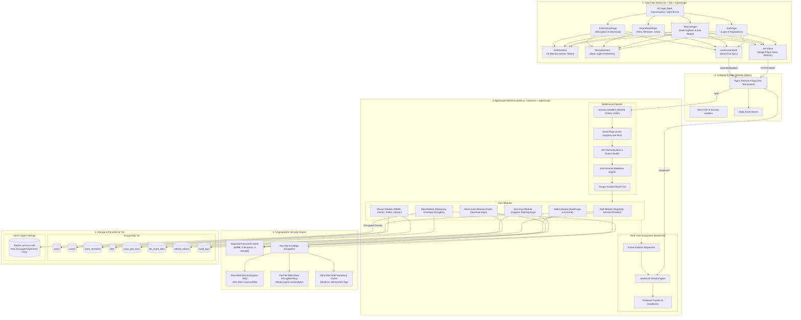
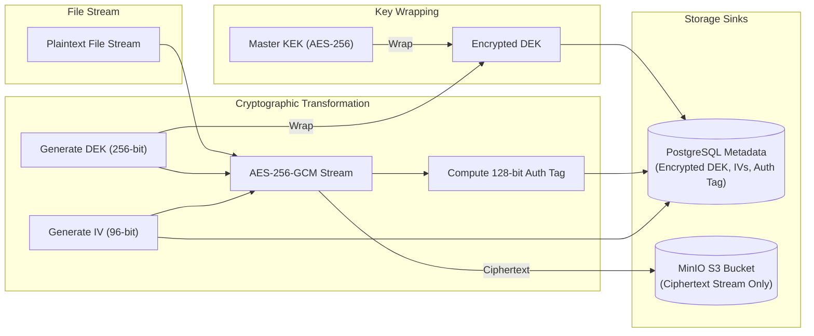
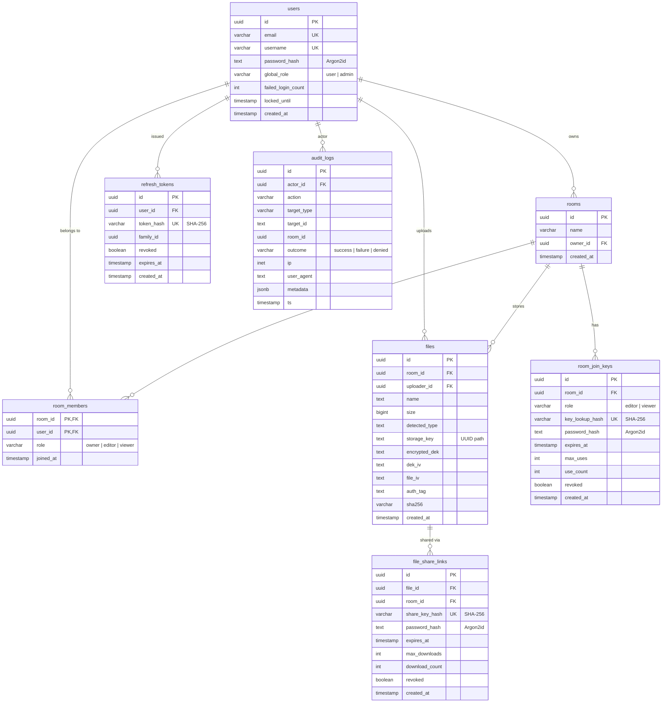
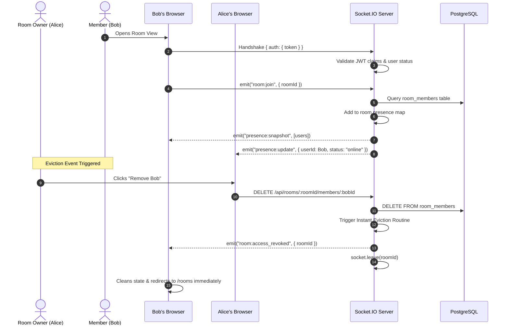

# PriVora — Secure Room-Based Vault & Real-Time File Sharing

[](./docs/security-test-report.md)
[](https://www.typescriptlang.org/)
[](https://nodejs.org/)
[](https://www.postgresql.org/)
[](https://min.io/)
[](./docs/security-test-report.md)

PriVora is an enterprise-grade, zero-knowledge, room-based collaborative vault application. It provides cryptographically enforced access control, streaming envelope encryption for file payloads, ephemeral and password-protected join/share keys, and instant WebSocket eviction—engineered to prevent data leakage, IDOR vulnerabilities, and unauthorized access even under hostile threat conditions.

---

## 🏛️ System Architecture


### End-to-End System Component Pipeline



---

## 🏛️ The 9 Core Security Pillars of PriVora

PriVora was engineered under strict zero-trust principles. Every tier of the platform incorporates defense-in-depth mechanisms targeting critical threat vectors:

| Security Mechanism | What Attack It Defeats | How PriVora Implements It |
| :--- | :--- | :--- |
| **1. Timing-Resistant Argon2id & Account Lockout** | Password cracking, credential stuffing, user enumeration via response timing | Argon2id hashing ($m=65536, t=3, p=4$); dummy hash verification on unknown users ensures constant-time execution; 5 failed attempts locks the account for 15 minutes in PostgreSQL. |
| **2. Ephemeral In-Memory Tokens & Family Rotation** | XSS token theft, session replay attacks, stolen refresh token reuse | Access token exists only in JavaScript memory (never in `localStorage`/`sessionStorage`); refresh token is an opaque 256-bit string stored in an `httpOnly`, `SameSite=Strict` cookie. If a consumed refresh token is ever re-used, the entire token family is immediately revoked. |
| **3. Uniform 404s for IDOR Protection** | Insecure Direct Object References (IDOR), resource existence enumeration | All queries join against `room_members`. Accessing a room or file you do not belong to returns a uniform `404 Not Found` (never `403 Forbidden`), preventing attackers from guessing whether a UUID exists. |
| **4. Cryptographic Room Join Keys** | Unauthorized room entry, link brute-forcing, race-condition over-joining | 256-bit CSPRNG base64url keys; server stores only the SHA-256 hash. Optional Argon2id password. Usage counts are incremented atomically via `UPDATE ... WHERE use_count < max_uses RETURNING id` to prevent race conditions. |
| **5. Multi-Layer File Upload Pipeline** | Remote Code Execution (RCE), file-type spoofing, double-extension bypass, path traversal | 25 MB hard cap + 500 MB quota; strict filename sanitization; double-extension rejection (e.g. `doc.pdf.exe`); magic-byte sniffing (`file-type`); isolated storage keys (`files/<uuid>`) ensuring user filenames never touch disk/S3. |
| **6. AES-256-GCM Envelope Encryption at Rest** | Cloud storage breach, plaintext file exfiltration from S3/MinIO | Every file gets a unique 256-bit Data Encryption Key (DEK). The DEK is encrypted using a Key Encryption Key (KEK) via AES-256-GCM. DEKs are zeroed out in RAM (`dek.fill(0)`) immediately after encryption/decryption. |
| **7. Atomic Ephemeral Public Share Links** | Link leaking, unlimited link scraping, unauthorized file distribution | Public share keys (`/s/:key`) with configurable expirations and max downloads (e.g. burn-after-reading). Database enforces download limits atomically to ensure that under 50 simultaneous requests, only the permitted count succeeds. |
| **8. Real-Time WebSocket Hardening & Instant Eviction** | Socket flooding, session hijacking, zombie connections | Handshake JWT authentication; per-socket token-bucket limiter (20 events/10s, disconnects after 3 violations); forced disconnect at JWT expiration (`exp - now`); real-time revocation instantly kicks removed members via `socketsLeave` and `room:access_revoked`. |
| **9. Redacted Audit Logging & Admin Controls** | Insider tampering, repudiation, credential leaks in logs | Asynchronous PostgreSQL `audit_logs` insertion that never blocks API responses. Recursive redaction strips sensitive keys (`password`, `token`, `dek`, `secret`). Global Admins can inspect audit trails and lock abusive accounts. |

---

## 🔒 Core Security Architecture & Mechanisms

### 1. Two-Tier Envelope Encryption for Files
Plaintext files **never touch the server disk or cloud storage**.
1. **Per-File Data Encryption Key (DEK):** For every uploaded file, a unique 256-bit cryptographic key is generated in memory via `crypto.randomBytes(32)`.
2. **Streaming AES-256-GCM:** The incoming multipart stream is encrypted on the fly with a unique 96-bit IV (`crypto.randomBytes(12)`). A 128-bit authentication tag is produced upon completion, guaranteeing tamper-resistance.
3. **Key Encryption Key (KEK):** The DEK is encrypted using the root master key (AES-256-GCM) with its own initialization vector.
4. **Storage Separation:** Encrypted DEKs and IVs are stored in PostgreSQL; raw ciphertext chunks are stored in MinIO. Neither storage layer alone can decrypt the file.



### 2. Dual-Token Authentication with Family Reuse Detection
PriVora eliminates client-side persistent storage of credentials:
* **Access Tokens (JWT):** Short-lived (15 minutes), held strictly in **JavaScript runtime memory** (never in `localStorage` or `sessionStorage`), mitigating XSS theft.
* **Refresh Tokens:** Long-lived (7 days), stored in an `HttpOnly`, `SameSite=Strict`, `Path=/api/auth` cookie. Stored in PostgreSQL as a SHA-256 hash.
* **Token Rotation & Family Revocation:** Every refresh permanently revokes the previous token. If an already-revoked refresh token is ever submitted (replay attack), PriVora detects the reuse and immediately **revokes the entire session family**, terminating all sessions for that lineage.
* **Concurrency Locking:** Frontend API client uses a single in-flight promise queue to ensure concurrent 401s do not trigger accidental rotation collisions.

### 3. Role-Based Access Control (RBAC) Matrix

| Action | Owner | Editor | Viewer | Non-Member |
| :--- | :---: | :---: | :---: | :---: |
| View Room & File List | ✅ | ✅ | ✅ | ❌ Uniform 404 |
| Download & Decrypt Files | ✅ | ✅ | ✅ | ❌ Uniform 404 |
| Upload Files (25MB Cap) | ✅ | ✅ | ❌ 403 Forbidden | ❌ Uniform 404 |
| Delete Files | ✅ | ✅ (Own files) | ❌ 403 Forbidden | ❌ Uniform 404 |
| Generate Cryptographic Join Keys | ✅ | ❌ 403 Forbidden | ❌ 403 Forbidden | ❌ Uniform 404 |
| Create Public Share Links | ✅ | ✅ | ❌ 403 Forbidden | ❌ Uniform 404 |
| Manage Members & Change Roles | ✅ | ❌ 403 Forbidden | ❌ 403 Forbidden | ❌ Uniform 404 |
| Delete Room | ✅ | ❌ 403 Forbidden | ❌ 403 Forbidden | ❌ Uniform 404 |

> **IDOR Protection:** Non-members receive uniform `404 Not Found` responses (never `403`), eliminating room ID enumeration or existence leakage.

---

## 🗄️ Database Entity-Relationship Model




---

## ⚡ Real-Time WebSocket Presence & Instant Eviction

PriVora enforces real-time synchronization over WebSocket connections via Socket.IO:



---

## 🎨 Dual-Mode Architectural UI System

PriVora features a tailored dual-theme user experience switchable in real time:

* **Dark Mode (Default):** Midnight Obsidian glassmorphic interface (`#07090e` / `#0d121d`) with vibrant Indigo (`#6366f1`), Cyan (`#06b6d4`), and Emerald (`#10b981`) accents.
* **Light Mode:** Architectural vault palette featuring warm brass (`#b57d12`), sage green (`#1f8a5f`), raised stone panels (`#ffffff`), and slate dividers (`#d8e0e7`).
* **Client Performance:** Theme preference is stored in `localStorage` without exposing any authentication tokens.

---

## 🚀 Getting Started

### Prerequisites
* **Node.js:** v20.x or higher
* **npm:** v10.x or higher
* **PostgreSQL:** v16.x (local or containerized)
* **Docker & Docker Compose** (optional for containerized deployment)

### 1. Clone & Configure Environment

```bash
git clone https://github.com/02Aditya2323/PriVora.git
cd PriVora
cp .env.example .env
```

Ensure `.env` contains secure cryptographic values:
```env
NODE_ENV=development
PORT=4000
DATABASE_URL=postgresql://localhost:5432/privora

ACCESS_TOKEN_SECRET=e32fcdbabff28524f9c085056ec4ed6f86b3cbc51378abd28f354cd3756b0b48
ACCESS_TOKEN_TTL=15m
REFRESH_TOKEN_TTL_DAYS=7

FILE_KEK_V1=aRENFWkxJlP1j+8OhkCBUWDhavATmFgAdUzx2JXfHz0=
FILE_KEK_CURRENT_VERSION=1

S3_ENDPOINT=http://localhost:9000
S3_BUCKET=privora-vault
S3_ACCESS_KEY=privora_minio_admin
S3_SECRET_KEY=privora_minio_secret_key_123!
S3_REGION=us-east-1

CORS_ORIGIN=http://localhost:5173
MAX_UPLOAD_BYTES=26214400
USER_QUOTA_BYTES=524288000
```

### 2. Database Migration

```bash
# Run schema and table migrations
npm run migrate
```

### 3. Local Development Mode

Start both backend and frontend concurrently:

```bash
# Terminal 1: Backend Server (Port 4000)
npm --prefix server run dev

# Terminal 2: Frontend Client (Port 5173 / 5174)
npm --prefix client run dev
```

### 4. Running with Docker Compose

To run the complete production-grade stack (Nginx + Express API + MinIO + Volume persistence):

```bash
docker compose up -d --build
```
* **Application URL:** `https://localhost` (or `http://localhost`)
* **MinIO Console:** `http://localhost:9001`

---

## 🧪 Automated Testing & Verification

PriVora includes comprehensive verification covering all security matrices, cryptographic flows, and concurrency limits:

```bash
# Run full Vitest suite (11 test suites, 79 tests)
npm test
```

### Test Suite Coverage Breakdown

```text
 ✓ tests/join-and-share-keys.test.ts  (9 tests)
 ✓ tests/share-links.test.ts          (3 tests)
 ✓ tests/auth.test.ts                 (10 tests)
 ✓ tests/upload-validation.test.ts    (9 tests)
 ✓ tests/socket.test.ts               (6 tests)
 ✓ tests/rbac.matrix.test.ts          (14 tests)
 ✓ tests/idor.test.ts                 (7 tests)
 ✓ tests/admin-and-audit.test.ts      (7 tests)
 ✓ tests/storage-keys.test.ts         (6 tests)
 ✓ tests/ratelimit.test.ts            (2 tests)
 ✓ tests/crypto.test.ts               (6 tests)

Test Files  11 passed (11)
Tests       79 passed (79)
Result      100% Pass Rate
```

For detailed attack vector proofs (including concurrent download races, token replay defense, double-extension upload rejection, and timing attack resistance), see the [Security Test Report](./docs/security-test-report.md).

---

## 📚 API Reference Overview

Detailed curl examples and JSON payloads are documented in [API_EXAMPLES.md](./docs/API_EXAMPLES.md).

* `POST /api/auth/register` — Create user identity with Argon2id hash.
* `POST /api/auth/login` — Authenticate and receive in-memory JWT + HttpOnly refresh cookie.
* `POST /api/auth/refresh` — Single-use token rotation and session refresh.
* `POST /api/auth/logout` — Revoke refresh token and clear cookie.
* `GET  /api/auth/me` — Retrieve active authenticated user profile.
* `GET  /api/rooms` — List rooms where the user is an owner, editor, or viewer.
* `POST /api/rooms` — Create a private vault room.
* `POST /api/rooms/join` — Join a room using an unguessable 256-bit join key.
* `POST /api/rooms/:id/join-keys` — Issue capped, expiring join keys.
* `POST /api/rooms/:id/files` — Upload multipart file with on-the-fly AES-256-GCM encryption.
* `GET  /api/rooms/:id/files/:fileId/download` — Stream and decrypt file ciphertext.
* `POST /api/rooms/:id/files/:fileId/share-links` — Create a public expiring download link.
* `GET  /api/s/:key/meta` — Query public file metadata without decrypting.
* `POST /api/s/:key/download` — Redeem and stream public decrypted file bytes.
* `GET  /api/admin/audit-logs` — Query filterable tamper-evident audit logs (Admins only).

---

## 📄 License

This project is licensed under the MIT License — see the [LICENSE](./LICENSE) file for details.
